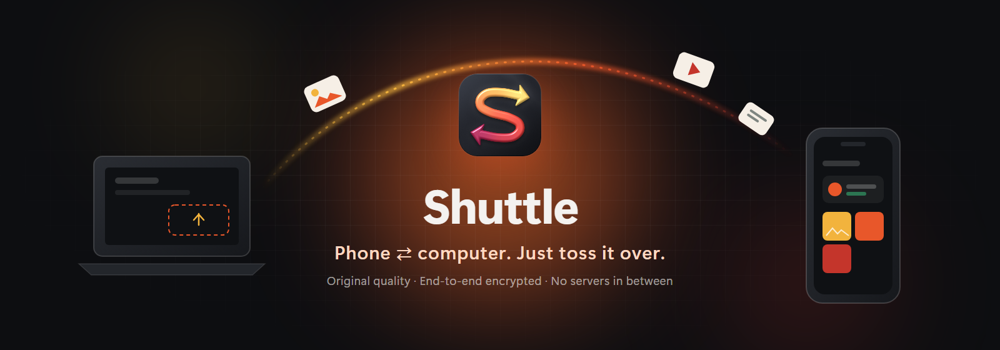
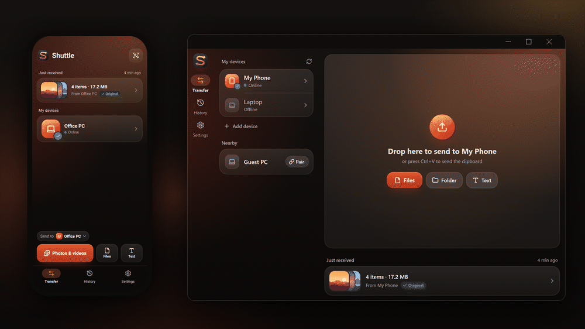
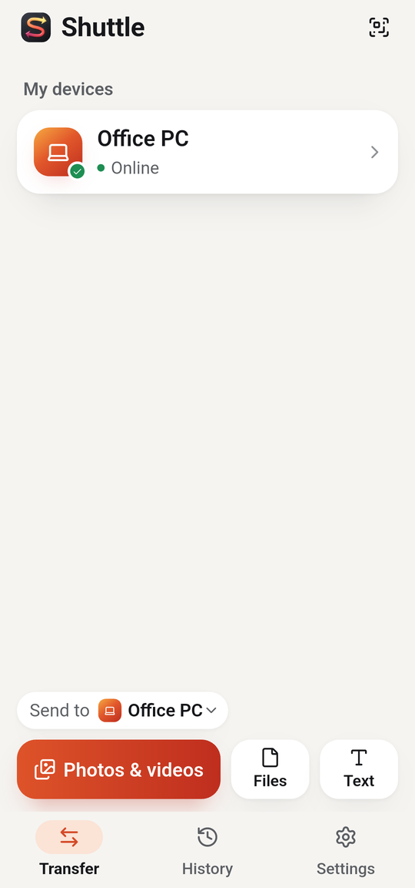
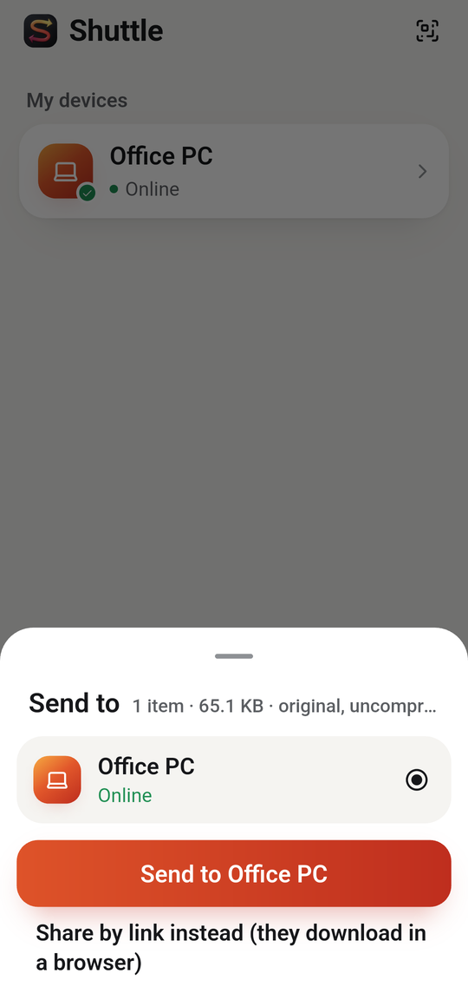
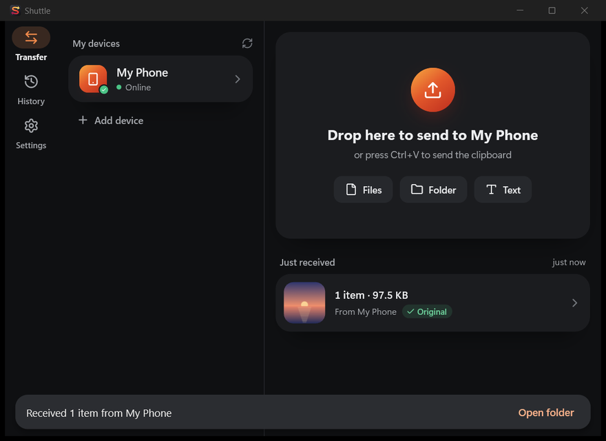
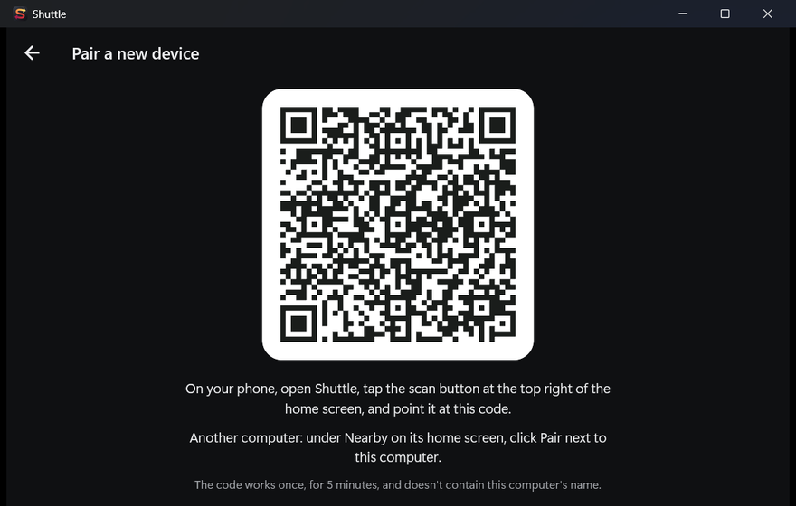

### AirDrop for the rest of us.

**Toss photos, videos, files and text between your Android phone and your Windows PC — in seconds.** 
Full quality. Encrypted. No cable, no cloud, no account.

[中文](README.zh-CN.md) · [Why Shuttle](#why-shuttle) · [Get started](#get-started-in-a-minute) · [FAQ](#faq) · [Security](SECURITY.md)

## You know the drill

You took a great photo. Now you want it on your computer. So you…

- 💬 **send it to yourself in a chat app** — and it arrives blurry and compressed,
- ☁️ **upload it to the cloud** — and wait, then download it again, then delete it,
- 🔌 **look for a cable** — which is never where you left it.

**Shuttle skips all of that.** Your phone and your computer talk to each other directly over your Wi-Fi.
Share → tap your PC → done. The original file, every byte checked.

## Why Shuttle

|   |   |
|---|---|
| 📸 **Your photos, untouched** | Originals only — no compression, no resizing. Every file is verified with SHA-256 on arrival. |
| ⚡ **As fast as your Wi-Fi** | Nothing goes through a server, so there's no upload and no download. In our tests, 200 photos (about 500 MB) went from phone to PC in under 40 seconds on ordinary home Wi-Fi. |
| 🤝 **Pair once, then it just works** | Scan a QR code one time. From then on your devices find each other, and files from them arrive without a single tap. |
| 📋 **Copy here, paste there** | Press <kbd>Ctrl</kbd>+<kbd>V</kbd> on your PC to send the clipboard to your phone. Share a link from your phone and it's ready to paste on your PC. |
| 🔒 **Private by design** | No account, no cloud, no tracking, no ads. Transfers are encrypted, and pairing compares 12 digits on both screens so no one can sneak in. |
| 🖥️ **Always ready** | Shuttle waits quietly in the tray, can start with Windows, and keeps itself up to date with signed updates. |
| 🌍 **Works away from home** | Add [Tailscale](https://tailscale.com) on both devices and it works over mobile data too — still without anyone's server in between. |

## How it compares

|   | **Shuttle** | Chat apps | Cloud drives | USB cable |
|---|:---:|:---:|:---:|:---:|
| Original quality | ✅ | ❌ usually compressed | ✅ | ✅ |
| No account needed | ✅ | ❌ | ❌ | ✅ |
| Works without internet | ✅ | ❌ | ❌ | ✅ |
| Files never leave your devices | ✅ | ❌ | ❌ | ✅ |
| No cable to find | ✅ | ✅ | ✅ | ❌ |

## Take a look

| Your phone | Pick where it goes | Your PC | Pair in one scan |
|:---:|:---:|:---:|:---:|
|  |  |  |  |

## Get started in a minute

1. **Install** Shuttle on your phone and your PC (buttons above) and connect both to the same Wi-Fi.
2. **Pair**: on the PC click **Add device**; on the phone tap the scan button and point it at the QR code. Both screens show the same 12 digits — confirm, and you're paired.
3. **Toss things over**:
   - **Phone → PC**: in any app, tap **Share → Shuttle**.
   - **PC → phone**: drag files onto Shuttle, or press <kbd>Ctrl</kbd>+<kbd>V</kbd>.

> **Windows says "Windows protected your PC"?** The installer isn't code-signed yet. Click **More info → Run anyway**. 
> **Android asks about unknown apps?** Allow your browser to install it once.

## FAQ

<b>Is it really free?</b>

Yes. Shuttle is open source (Apache-2.0), with no ads, no paid tier and no account.

<b>Is it safe? Could someone else on the Wi-Fi get my files?</b>

Files go directly between your devices and are encrypted on the way. Only devices you paired (and checked the 12 digits for) can send to you without asking; anything else needs your OK first. Details in [SECURITY.md](SECURITY.md).

<b>Do I need internet?</b>

No. Both devices just need to be on the same Wi-Fi network — even one with no internet. For use away from home, install Tailscale on both.

<b>The phone can't find my PC.</b>

Make sure both are on the same network (guest networks and some routers keep devices apart). On Windows, allow Shuttle through the firewall on **private** networks and set your home Wi-Fi to **Private**. Office and school networks often block devices from seeing each other — Tailscale works around that.

<b>iPhone? Mac? Linux?</b>

Android and Windows today, and a macOS build is in testing. iPhone and Linux aren't available yet — [open an issue](../../issues/new/choose) to tell us which one you want most.

<b>How is this related to LocalSend?</b>

Shuttle is built on [LocalSend](https://github.com/localsend/localsend), the excellent open-source file-sharing app. It keeps LocalSend's solid transfer and encryption core and adds a redesigned interface, QR pairing with verification, trusted "My devices", clipboard sending, Tailscale support and signed auto-updates. Thank you to LocalSend's author and contributors.

## What's next

- [ ] Signed macOS build
- [ ] Resume large transfers after a dropped connection
- [ ] Send queue: files wait on your PC and go out as soon as your phone is back online

Have an idea? [Open an issue](../../issues/new/choose).

## Contributing

Bug reports, ideas and pull requests are all welcome — see [CONTRIBUTING.md](CONTRIBUTING.md). Found a security problem? Please report it privately as described in [SECURITY.md](SECURITY.md).

**If Shuttle saved you a cable hunt, a ⭐ helps others find it.**

## License

[Apache-2.0](LICENSE). Shuttle is a modified version of [LocalSend](https://github.com/localsend/localsend) (Copyright 2022-2026 Tien Do Nam, Apache-2.0); all changes are released under Apache-2.0 as well.
