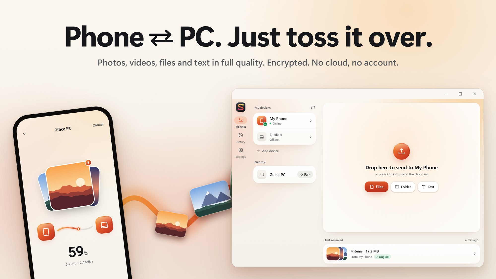
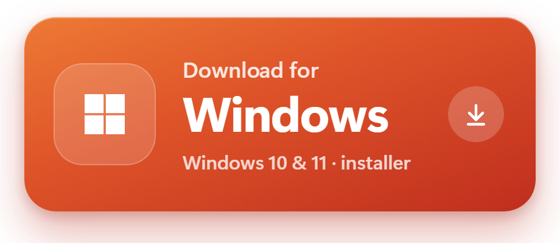
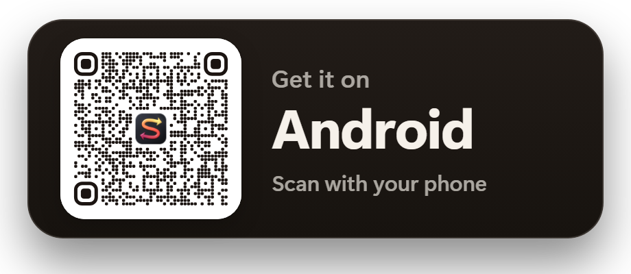
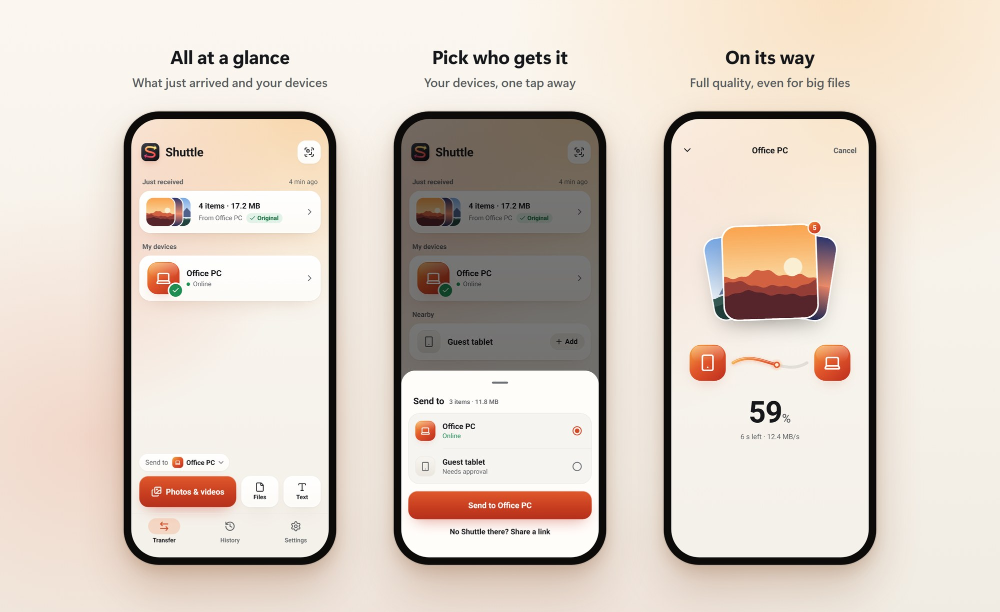
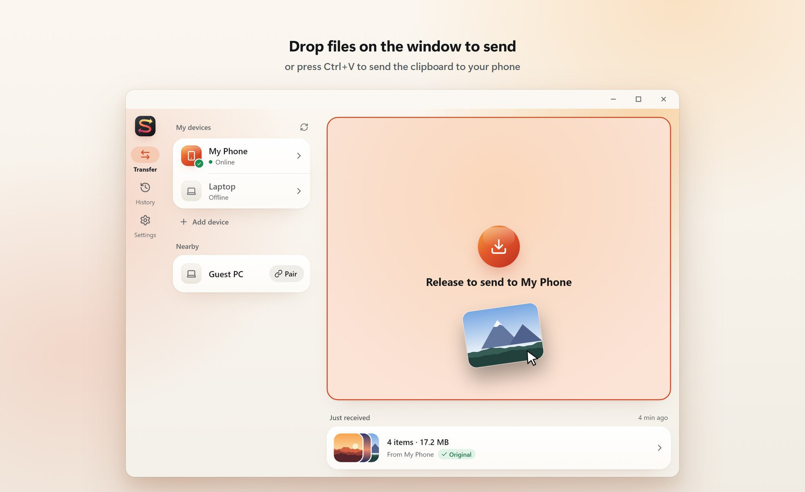

<picture>
  <source media="(prefers-color-scheme: dark)" srcset="docs/readme/hero-dark.jpg">
  
</picture>

Free and open source · No account · [All downloads](https://github.com/JackWorld99/shuttle/releases/latest) · [中文](README.zh-CN.md)

## Install in a minute

<table>
<tr><th width="50%">Windows</th><th width="50%">Android</th></tr>
<tr><td valign="top">

1. Download and open the installer.
2. Windows says **"Windows protected your PC"**? Click **More info → Run anyway**. The installer isn't code-signed yet.
3. Open Shuttle. Closed, it keeps waiting in the tray.

</td><td valign="top">

1. Scan the QR code above with your phone.
2. Open the download. If Android asks, let your browser **install unknown apps**.
3. Open Shuttle and allow access to photos.

</td></tr>
</table>

**Pair once:** on the PC click **Add device**, on the phone tap the scan button (top right) and point it at the code. From then on, files from your devices just arrive.

## Why Shuttle

- **Originals, untouched.** No compression, no resizing. Every file is checked with SHA-256 when it arrives.
- **As fast as your Wi-Fi.** Straight from one device to the other, no server in between.
- **Pair once.** After one QR scan your devices find each other, and files arrive without a tap.
- **Copy here, paste there.** <kbd>Ctrl</kbd>+<kbd>V</kbd> sends the PC's clipboard to your phone; a link shared on the phone is ready to paste on the PC.
- **Nothing lost on the way.** Phone offline? It waits and goes out when it's back. Cut off halfway? It picks up where it stopped.
- **Private by design.** No account, no cloud, no tracking. Encrypted from device to device.

## Take a look

<picture>
  <source media="(prefers-color-scheme: dark)" srcset="docs/readme/look-phone-dark.jpg">
  
</picture>

<picture>
  <source media="(prefers-color-scheme: dark)" srcset="docs/readme/look-pc-dark.jpg">
  
</picture>

## How it compares

|   | **Shuttle** | Chat apps | Cloud drives | USB cable |
|---|:---:|:---:|:---:|:---:|
| Original quality | ✅ | ❌ usually compressed | ✅ | ✅ |
| No account needed | ✅ | ❌ | ❌ | ✅ |
| Works without internet | ✅ | ❌ | ❌ | ✅ |
| Files never leave your devices | ✅ | ❌ | ❌ | ✅ |
| No cable to find | ✅ | ✅ | ✅ | ❌ |

## FAQ

<b>Is it really free?</b>

Yes. Shuttle is open source (Apache-2.0), with no ads, no paid tier and no account.

<b>Is it safe? Could someone else on the Wi-Fi get my files?</b>

Files go directly between your devices and are encrypted on the way. Only devices you paired can send to you without asking; anything else needs your OK first. Details in [SECURITY.md](SECURITY.md).

<b>Do I need internet?</b>

No. Both devices just need to be on the same Wi-Fi, even one with no internet. Away from home, install [Tailscale](https://tailscale.com) on both and it works over mobile data too.

<b>The phone can't find my PC.</b>

Make sure both are on the same network (guest networks and some routers keep devices apart). On Windows, allow Shuttle through the firewall on **private** networks and set your home Wi-Fi to **Private**.

<b>iPhone? Mac? Linux?</b>

Android and Windows today, and a macOS build is in testing. [Open an issue](../../issues/new/choose) to tell us which one you want most.

<b>How is this related to LocalSend?</b>

Shuttle is built on [LocalSend](https://github.com/localsend/localsend), the excellent open-source file-sharing app. It keeps LocalSend's transfer and encryption core and adds a redesigned interface, QR pairing, trusted "My devices", clipboard sending, a send queue, resumable transfers, Tailscale support and signed auto-updates. Thank you to LocalSend's author and contributors.

## Contributing

Bug reports, ideas and pull requests are welcome; see [CONTRIBUTING.md](CONTRIBUTING.md). Found a security problem? Please report it privately as described in [SECURITY.md](SECURITY.md).

## License

[Apache-2.0](LICENSE). Shuttle is a modified version of [LocalSend](https://github.com/localsend/localsend) (Copyright 2022-2026 Tien Do Nam, Apache-2.0); all changes are released under Apache-2.0 as well.
