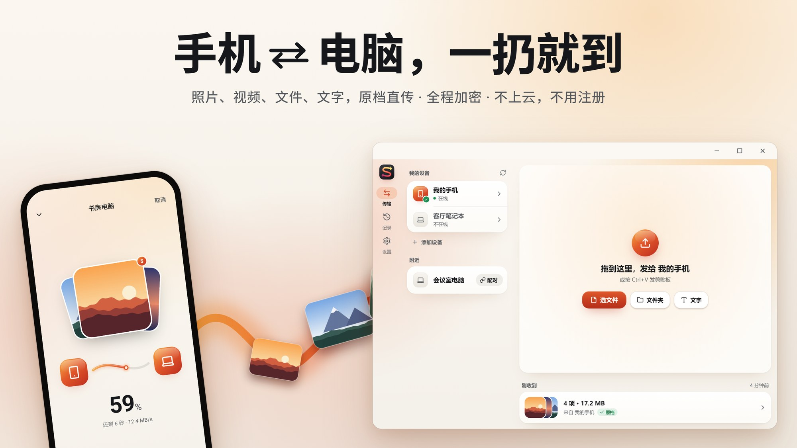
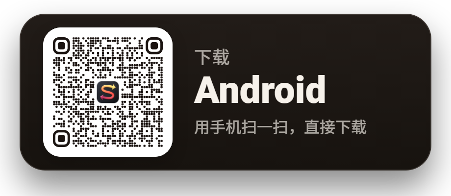
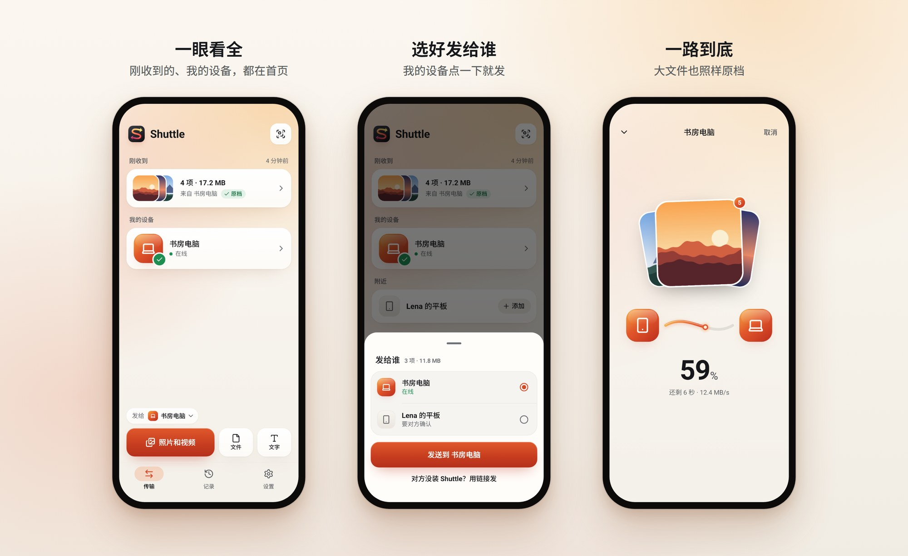
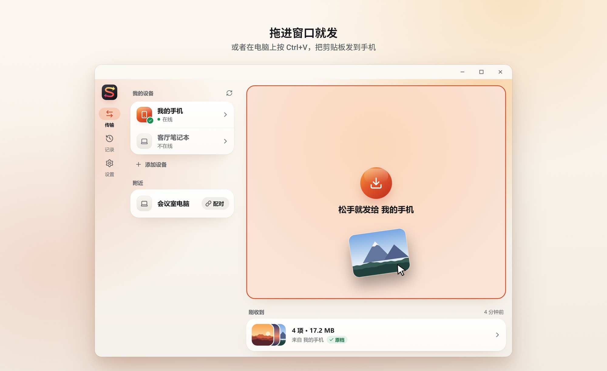

<picture>
  <source media="(prefers-color-scheme: dark)" srcset="docs/readme/hero-zh-dark.jpg">
  
</picture>

免费开源 · 不用注册 · [全部下载](https://github.com/JackWorld99/shuttle/releases/latest) · [English](README.md)

## 一分钟装好

<table>
<tr><th width="50%">Windows</th><th width="50%">安卓</th></tr>
<tr><td valign="top">

1. 下载安装包，打开它。
2. 弹出 **「Windows 已保护你的电脑」**？点 **更多信息 → 仍要运行**。安装包暂时还没有代码签名。
3. 打开 Shuttle。关掉窗口后它仍在右下角托盘里等着收。

</td><td valign="top">

1. 用手机扫上面的二维码。
2. 打开下载好的文件。如果手机提示，允许浏览器 **安装未知应用**。
3. 打开 Shuttle，允许访问照片。

</td></tr>
</table>

**配对一次就好：** 电脑上点 **添加设备**，手机上点右上角的扫码按钮，对准二维码。之后你的设备发来的东西会直接收下。

## 为什么用 Shuttle

- **原档，一个字节都不改。** 不压缩、不缩小，每个文件到了都用 SHA-256 核对。
- **快到只看你的 WiFi。** 两台设备直接传，中间不经过任何服务器。
- **配对一次。** 扫一次码，之后两边自动认出对方，发来的东西不用点就收下。
- **这边复制，那边粘贴。** 电脑上按 <kbd>Ctrl</kbd>+<kbd>V</kbd> 把剪贴板发到手机；手机分享一个链接，电脑上直接能粘贴。
- **路上不丢东西。** 手机不在线？先排着，回来就自动发。传到一半断了？从断开的地方接着传。
- **从设计上就保护隐私。** 不用注册、不上云、不追踪，全程加密。

## 看一眼

<picture>
  <source media="(prefers-color-scheme: dark)" srcset="docs/readme/look-phone-zh-dark.jpg">
  
</picture>

<picture>
  <source media="(prefers-color-scheme: dark)" srcset="docs/readme/look-pc-zh-dark.jpg">
  
</picture>

## 和常见做法比一比

|   | **Shuttle** | 聊天软件 | 网盘 | 数据线 |
|---|:---:|:---:|:---:|:---:|
| 原图原画质 | ✅ | ❌ 一般会压缩 | ✅ | ✅ |
| 不用注册账号 | ✅ | ❌ | ❌ | ✅ |
| 没有外网也能用 | ✅ | ❌ | ❌ | ✅ |
| 文件不离开你的设备 | ✅ | ❌ | ❌ | ✅ |
| 不用找线 | ✅ | ✅ | ✅ | ❌ |

## 常见问题

<b>真的免费吗？</b>

是的。Shuttle 开源（Apache-2.0），没有广告、没有付费版、不用注册。

<b>安全吗？同一个 WiFi 下的人能收到我的文件吗？</b>

文件只在你的设备之间直接传，一路加密。只有你配对过的设备才能直接发给你，其他设备都要你点同意。详见 [SECURITY.md](SECURITY.md)。

<b>需要联网吗？</b>

不需要。两边连着同一个 WiFi 就行，哪怕这个 WiFi 不能上网。不在一起的时候，两边装上 [Tailscale](https://tailscale.com)，用手机流量也能传。

<b>手机找不到电脑？</b>

确认两边连的是同一个网络（访客网络、有的路由器会把设备隔开）。Windows 请允许 Shuttle 在**专用网络**上通信，家里的 WiFi 也请设成「专用网络」。

<b>iPhone、Mac、Linux 呢？</b>

现在支持安卓和 Windows，Mac 版正在测试。想要哪个就[提个 Issue](../../issues/new/choose)告诉我们。

<b>和 LocalSend 是什么关系？</b>

Shuttle 基于优秀的开源项目 [LocalSend](https://github.com/localsend/localsend)：保留了它的传输和加密核心，重做了界面，加上了扫码配对、受信任的「我的设备」、剪贴板发送、待发队列、断点续传、Tailscale 支持和带签名的自动更新。感谢 LocalSend 的作者和所有贡献者。

## 参与

欢迎报 Bug、提想法、提 Pull Request，详见 [CONTRIBUTING.md](CONTRIBUTING.md)。发现安全问题请按 [SECURITY.md](SECURITY.md) 私下报告。

## 许可证

[Apache-2.0](LICENSE)。Shuttle 基于 [LocalSend](https://github.com/localsend/localsend)（Copyright 2022-2026 Tien Do Nam，Apache-2.0）修改而来，所有改动同样以 Apache-2.0 发布。
