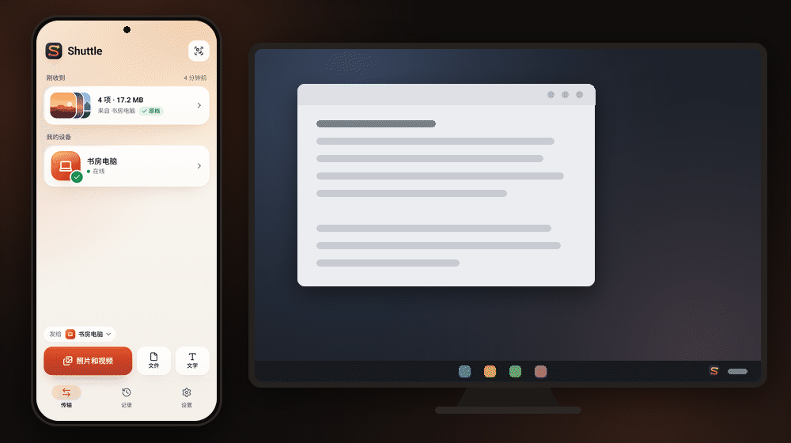
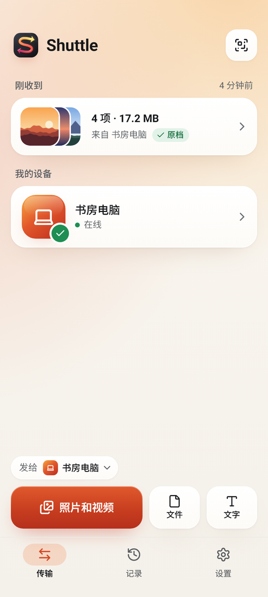
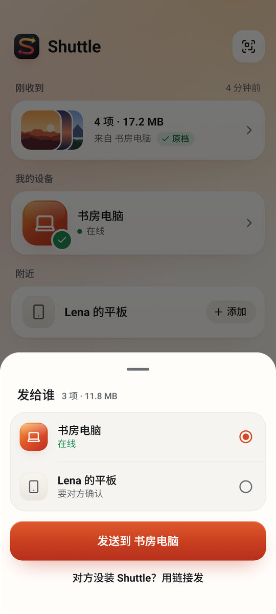
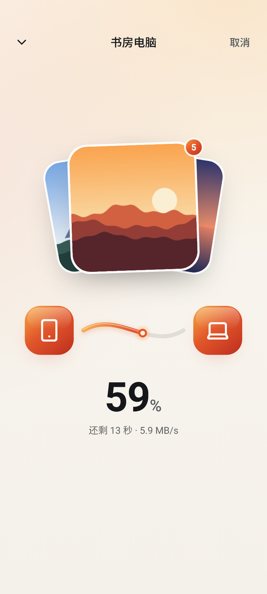
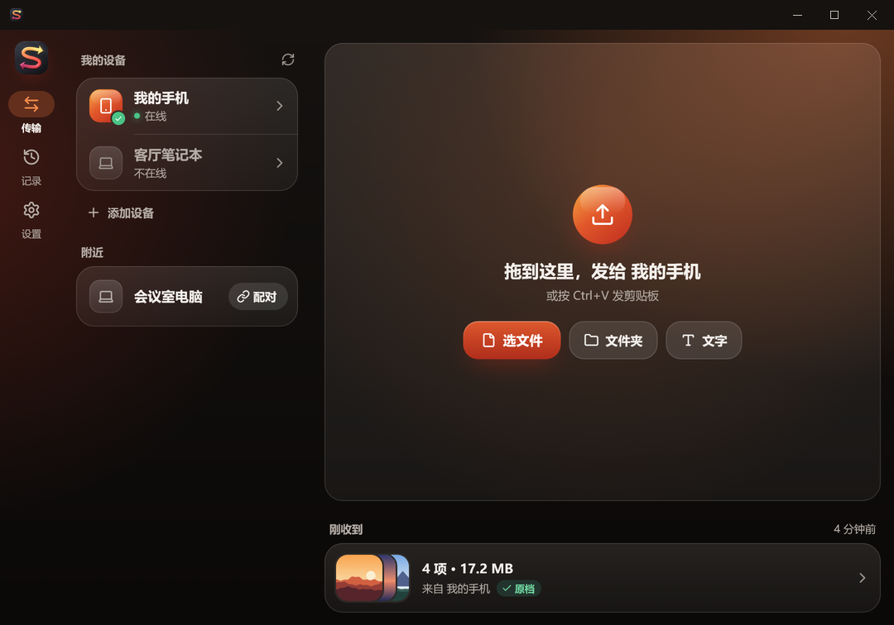

### 手机和电脑之间，一扔就到。

**安卓手机 ⇄ Windows 电脑，照片、视频、文件、文字，几秒钟传过去。** 
原图原画质 · 全程加密 · 不用数据线、不过云盘、不用注册

[English](README.md) · [为什么选它](#为什么选-shuttle) · [一分钟上手](#一分钟上手) · [常见问题](#常见问题) · [安全](SECURITY.md)

## 这些场景你一定熟

拍了一张好照片，想放到电脑上。于是你……

- 💬 **用聊天软件发给自己**：一看，糊了，被压缩过了；
- ☁️ **传到网盘**：等上传、再下载、回头还得记得删；
- 🔌 **找数据线**：永远不在你上次放的地方。

**Shuttle 把这些全省了。** 手机和电脑在同一个 WiFi 下直接对传：
点「分享」→ 点你的电脑 → 好了。原文件，一个字节都不差。

## 为什么选 Shuttle

|   |   |
|---|---|
| 📸 **照片原封不动** | 只传原文件，不压缩、不缩小，每个文件到了都用 SHA-256 核对一遍。 |
| ⚡ **快到只看你家 WiFi** | 不经过任何服务器，没有"上传再下载"。实测：200 张照片（约 500 MB）从手机到电脑，普通家用 WiFi 不到 40 秒。 |
| 🤝 **配一次，以后都不用管** | 扫一次二维码。之后两边自动认出对方，发来的东西直接收，一下都不用点。 |
| 📋 **这边复制，那边粘贴** | 电脑上按 <kbd>Ctrl</kbd>+<kbd>V</kbd> 就把剪贴板发到手机；手机分享一个链接，电脑上直接能粘贴。 |
| 🔒 **从设计上就保护隐私** | 不用注册、不上云、不追踪、没广告。传输全程加密；只有扫了你屏幕上二维码的那台设备才能配对，别人冒充不了。 |
| 🖥️ **随时待命** | 电脑上安静地待在托盘里，可以开机自动启动，还会自己更新（每个更新都有签名校验）。 |
| 🌍 **出门在外也能传** | 两边都装上 [Tailscale](https://tailscale.com)，用手机流量也能传，照样全程加密。 |

## 和常见做法比一比

|   | **Shuttle** | 聊天软件 | 网盘 | 数据线 |
|---|:---:|:---:|:---:|:---:|
| 原图原画质 | ✅ | ❌ 一般会压缩 | ✅ | ✅ |
| 不用注册账号 | ✅ | ❌ | ❌ | ✅ |
| 没有外网也能用 | ✅ | ❌ | ❌ | ✅ |
| 文件不离开你的设备 | ✅ | ❌ | ❌ | ✅ |
| 不用找线 | ✅ | ✅ | ✅ | ❌ |

## 看一眼

<table>
<tr><th>手机首页</th><th>选发给谁</th><th>正在发</th></tr>
<tr>
<td align="center"></td>
<td align="center"></td>
<td align="center"></td>
</tr>
<tr><th colspan="3">电脑首页</th></tr>
<tr><td colspan="3" align="center"></td></tr>
</table>

## 一分钟上手

1. **安装**：手机和电脑都装上 Shuttle（上面的按钮），连同一个 WiFi。
2. **配对**：电脑上点「添加设备」；手机上点右上角的扫码按钮对准二维码。扫完就配好了。
3. **开始扔**：
   - **手机 → 电脑**：在任何 App 里点「分享 → Shuttle」。
   - **电脑 → 手机**：把文件拖进 Shuttle，或者按 <kbd>Ctrl</kbd>+<kbd>V</kbd>。

> **Windows 提示"已保护你的电脑"？** 安装包还没有代码签名，点 **更多信息 → 仍要运行**。 
> **安卓提示"安装未知应用"？** 允许浏览器安装一次就好。

## 常见问题

<b>真的免费吗？</b>

是的。Shuttle 开源（Apache-2.0），没有广告、没有付费版、不用注册。

<b>安全吗？同一个 WiFi 下的人能收到我的文件吗？</b>

文件只在你的设备之间直接传，一路加密。只有你配对过的设备才能直接发给你，其他设备都要你点同意。配对靠你屏幕上的二维码，两台电脑之间则要互相输入对方显示的 6 位数字，中间人插不进来。详见 [SECURITY.md](SECURITY.md)。

<b>需要联网吗？</b>

不需要。两边连着同一个 WiFi 就行，哪怕这个 WiFi 不能上网。不在一起的时候，两边装 Tailscale 也能传。

<b>手机找不到电脑？</b>

确认两边连的是同一个网络（访客网络、有的路由器会把设备隔开）。Windows 第一次运行时请允许 Shuttle 在**专用网络**上通信，家里的 WiFi 也请设成"专用网络"。公司、学校的网络常常不让设备互相连接，这时可以用 Tailscale。

<b>iPhone、Mac、Linux 呢？</b>

现在支持安卓和 Windows，Mac 版正在测试。iPhone 和 Linux 暂时还没有，想要哪个就[提个 Issue](../../issues/new/choose)告诉我们。

<b>和 LocalSend 是什么关系？</b>

Shuttle 基于优秀的开源项目 [LocalSend](https://github.com/localsend/localsend)：保留了它扎实的传输和加密核心，重做了界面和交互，加上了扫码配对、受信任的「我的设备」、剪贴板发送、Tailscale 支持和带签名的自动更新。感谢 LocalSend 的作者和所有贡献者。

## 接下来要做的

- [ ] 有签名的 Mac 版
- [ ] 大文件断点续传
- [ ] "待发"队列：手机不在线时文件先在电脑上排队，手机一上线就自动发过去

有想法？[提个 Issue](../../issues/new/choose)。

## 参与

欢迎报 Bug、提想法、提 Pull Request，详见 [CONTRIBUTING.md](CONTRIBUTING.md)。发现安全问题请按 [SECURITY.md](SECURITY.md) 私下报告。

**如果 Shuttle 帮你省了一次找数据线，点个 ⭐ 让更多人看到它。**

## 许可证

[Apache-2.0](LICENSE)。Shuttle 基于 [LocalSend](https://github.com/localsend/localsend)（Copyright 2022-2026 Tien Do Nam，Apache-2.0）修改而来，所有改动同样以 Apache-2.0 发布。
